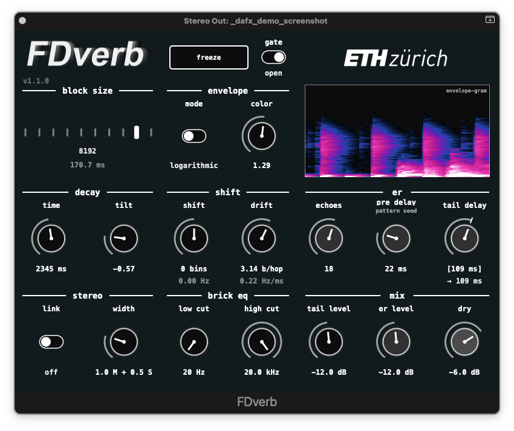

# FDverb

A frequency-domain artificial reverberation effect.
FDverb is implemented as a plugin (see [plugin/](plugin/)) and as an offline Python implementation (see [python/](python/)).

Check the [FDverb project page](https://iip.ethz.ch/research/syneth-audio-synthesis/project-FDverb.html) for supplementary material.



## Credits

Developed by Nishanth Kumar, Silvan Krebs, David Wieland, Christoph Studer, and Jonas Roth at the [Integrated Information Processing (IIP) Group at ETH Zurich](https://iip.ethz.ch). 

Built using the [JUCE](https://github.com/juce-framework/JUCE) framework.

## Features

- Frequency-domain reverb processing using STFT
- Envelope follower with decay control
- Frequency-dependent decay (tilt)
- Spectral shifting (static and dynamic)
- Brick-wall EQ (low cut / high cut)
- Freeze mode with input gate
- Synthetic early reflections
- Stereo link and width control

### Python-Only Features
The Python implementation has a number of extra features implemented, compared to the plugin implementation:

- Load a preset early-reflections IR (config parameter `early_reflections:er_preset`).
- Send early-reflections signal to tail reverberator (config parameter `early_reflections:er2tail_gain`).
- Tune the early-reflections decay rate (config parameter `early_reflections:decay_rate`, in dB/ms).
  The plugin fixes this rate at 0.2 dB/ms, so presets must keep that value to match it.

## Getting Started

See our [releases](https://github.com/IIP-Group/FDverb/releases) for pre-compiled plugin binaries.

Alternatively, follow the instructions below to build from source.

```bash
git clone --recurse-submodules git@github.com:IIP-Group/FDverb.git
cd FDverb
```

## Python (Jupyter Notebook)
offline reference implementation

### Setup

Create virtual environment and install requirements:
```bash
cd python
python3.13 -m venv env_fdverb
source env_fdverb/bin/activate
pip install -r requirements.txt
```

### Configuration
Parameter presets are found in the [presets/](presets/) directory.

The paths to the active parameter config and audio input file are set at the beginning of the notebook.
To tweak parameters, edit `presets/default.yaml` or create a new YAML and adjust the path in the notebook.

### Run
Open Jupyter notebook [python/FDverb.ipynb](python/FDverb.ipynb) and run cells.

Output is saved to `python/out/out.wav` and plays automatically.

### Development

Recommended development requirements are provided in `python/requirements-dev.txt`.
```bash
pip install -r requirements-dev.txt
nbstripout --install
```

User requirements are maintained in `python/requirements.in` and compiled using
```bash
pip-compile requirements.in
```


## C++ (JUCE)
### Requirements
- CMake 3.22+
- C++17-compatible compiler
- JUCE framework

### Building
```bash
cd plugin
cmake --preset macos                  # or: windows
cmake --build --preset macos-release  # or: windows-release
```

Build presets: `macos-debug`, `macos-release`, `windows-debug`, `windows-release`.
Use Release for listening tests and releases — Debug builds are unoptimized and show
`-debug` next to the version number in the UI.

Plugins are output to `plugin/build/FDverb_artefacts/<Config>/`, where `<Config>` is
`Debug` or `Release`, and are copied to the standard user plugin directory after each
build. To disable the copy, remove this line from `plugin/CMakeLists.txt`:
```cmake
    COPY_PLUGIN_AFTER_BUILD TRUE
```
On Windows the default location `C:\Program Files\Common Files\VST3\` is a protected
system folder, so the copy fails unless Visual Studio runs as administrator.

### IDEs
`cmake --preset macos` also generates `plugin/build/FDverb.xcodeproj`. Visual Studio
(File > Open > Folder...) and VS Code (CMake Tools) read the presets directly; select the
configuration from the preset list.

### Runtime Measurement Mode

To re-run the `processFrame()` timing measurements, build with `-DFDVERB_MEASURE_TIMING=ON`:
```bash
cd plugin
cmake --preset macos -DFDVERB_MEASURE_TIMING=ON
cmake --build --preset macos-release
```
While the plugin runs, measurements are appended to `~/Desktop/fdverb_runtime_measurements/<timestamp>_blocksize_<N>.txt`.
Since the AU is declared sandbox-safe (`AU_SANDBOX_SAFE`), a sandboxed host may redirect that path into its own container, e.g. `~/Library/Containers/<host>/Data/Desktop/`.
Run `python/scripts/runtime_analysis.ipynb` to analyze the results — it reads directly from that directory.
Rebuild with `-DFDVERB_MEASURE_TIMING=OFF` when done.

### Factory Presets

FDverb ships with factory presets. Whether they appear automatically or need a one-time install depends on your host.

#### Logic / Reaper

Nothing to do. The presets are embedded in the plugin and appear in the host's native preset menu automatically.

#### Ableton Live / Cubase / Studio One

These hosts don't read the plugin's built-in preset list; they look for `.vstpreset` files on disk.
Copy the files from [presets/vstpreset/](presets/vstpreset/) into the VST3 preset folder for your OS:

- **macOS:** `~/Library/Audio/Presets/IIP/FDverb/`
- **Windows:** `%USERPROFILE%\Documents\VST3 Presets\IIP\FDverb\`
- **Linux:** `~/.vst3/presets/IIP/FDverb/`

Then restart the host (or rescan its preset/media library) so it picks them up.

### Editing or adding a preset

These instructions are for contributors changing the presets that ship with FDverb.
If you just want to use the existing presets, see [Factory Presets](#factory-presets) above.

A preset exists in three forms: 
* **YAML** source in [presets/](presets/) is authoritative.
* **JUCE state XML** in [presets/generated/](presets/generated/) is derived from it and embedded in the binary (Logic/Reaper).
* **`.vstpreset`** files in [presets/vstpreset/](presets/vstpreset/) are exported from the built plugin (Ableton/Cubase/Studio One).

#### Adding a new preset

1. Create the YAML in `presets/`, following `presets/default.yaml`.
2. Add it to `PRESET_FILES` in `python/scripts/yaml_to_preset.py` (filename + display name).
3. Add its `BinaryData::` entry to `kPresets[]` in `plugin/src/PluginProcessor.cpp` (JUCE strips hyphens from BinaryData identifiers).
4. Reconfigure CMake (`cmake --preset macos # or windows`, see above) so the glob picks up the new XML.

Then run the build steps below from step **6**.

#### Editing a preset

5. Edit the YAML in `presets/`.
6. Regenerate the XML: `python python/scripts/yaml_to_preset.py` (from the repo root).
7. Re-export the `.vstpreset` file: load FDverb in Reaper, select the preset, and save it as a `.vstpreset` into `presets/vstpreset/`.
8. Build, and commit the YAML plus the updated `generated/` and `vstpreset/` files.

## License
FDverb is licensed under the GNU Affero General Public License v3.0 (AGPL-3.0).
The JUCE framework is included as a Git submodule, which is used under the terms of the AGPL.
The JUCE framework remains subject to its own license, which is included in the JUCE submodule.
